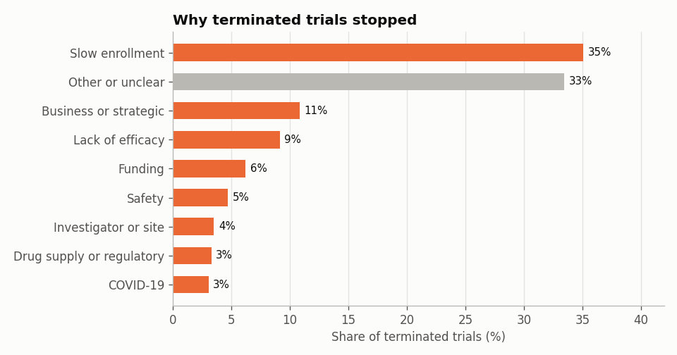
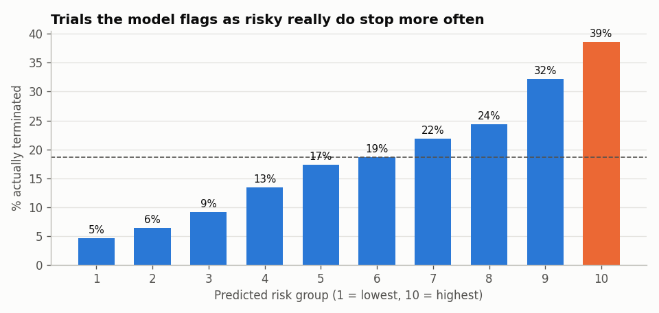

[English](README.md) | **Português**

# Porque É que os Ensaios Clínicos Terminam Antes do Tempo?

Cerca de 1 em cada 6 ensaios clínicos é **interrompido** antes do fim previsto. Houve doentes expostos a tratamentos experimentais, gastou-se dinheiro, e a pergunta científica fica muitas vezes sem resposta. Este projeto analisa **46 911 ensaios de fase 2 e 3** do ClinicalTrials.gov para perceber porque param, quais param mais e se é possível prever a interrupção logo no registo.

> Os notebooks e o código estão em inglês, para chegar a um público mais alargado.

**Dados:** [API v2 do ClinicalTrials.gov](https://clinicaltrials.gov/data-api/api): ensaios de intervenção de fase 2/3 iniciados entre 2008 e 2019, já concluídos ou interrompidos.

**Resumo em linguagem simples:** [abre o dashboard online](https://ncdomingues.github.io/clinical-trial-termination/trials-at-a-glance.html) ([código](trials-at-a-glance.html)), uma página de síntese para quem não é técnico, em inglês e português.

**Outros projetos:** [Previsão de toxicidade Tox21](https://github.com/ncdomingues/tox21-toxicity) · [Dados da educação em Portugal](https://github.com/ncdomingues/portuguese-education-data)

## Principais resultados
1. **A maioria dos ensaios não para porque o medicamento falhou.** As razões mais comuns são o recrutamento lento (35% das interrupções), decisões de negócio ou estratégicas (11%) e falta de financiamento (6%). A falta de eficácia (9%) e a segurança (5%) são menos frequentes.

   

2. **A indústria e a academia param por razões diferentes.**
   - Os ensaios da indústria param por razões de negócio (22%) e falta de eficácia (13%).
   - Os académicos param por recrutamento lento (48%), financiamento (11%) e saída do investigador (6%).
3. **Alguns ensaios param muito mais do que outros.**
   - Os ensaios de cancro são os mais interrompidos (25%), os de infeções os menos (10%).
   - Os ensaios abertos e não aleatorizados param mais do que os ocultados e aleatorizados (20–21% contra 13–14%).
   - Critérios de elegibilidade mais longos e restritivos andam a par com mais interrupções (de 11% a 21%).
4. **A interrupção só é moderadamente previsível no registo.** Um modelo de gradient boosting testado em ensaios iniciados em 2016–2019 chega a um ROC-AUC de 0,69, ou 0,70 combinado com um modelo de texto. Ainda assim, o décimo de ensaios com maior risco foi interrompido 8 vezes mais do que o décimo com menor risco (39% contra 5%).

   

5. **Um exemplo clássico de fuga de informação (data leakage).** Juntar o número *real* de doentes inscritos sobe o ROC-AUC para 0,82, mas esse número só se conhece depois do ensaio. Um ensaio que parou cedo inscreveu naturalmente menos doentes.
6. **Os ensaios com um centro nos EUA são mais interrompidos (21% contra 12%).** É provavelmente, em parte, um efeito de registo: a lei americana obriga a atualizar o estado do ensaio, enquanto noutros países ensaios parados ficam muitas vezes com estado "desconhecido".

## Estrutura
```
src/download_data.py     descarrega os ensaios da API do ClinicalTrials.gov (~47 000 registos)
src/build_dataset.py     uma linha por ensaio: desenho, áreas da doença, texto e razões de interrupção agrupadas por regras de palavras-chave
src/style.py             estilo comum dos gráficos
notebooks/01_why_trials_stop.ipynb         razões, e interrupção por fase, promotor, desenho, área da doença e ano
notebooks/02_predict_termination.ipynb     fuga de informação, comparação de modelos, importância das variáveis, modelo de texto, grupos de risco
figures/                 gráficos exportados
trials-at-a-glance.html  dashboard em linguagem simples
```

## Como correr
```bash
pip install -r requirements.txt
python src/download_data.py     # alguns minutos, ~185 MB
python src/build_dataset.py
jupyter notebook notebooks/
```

## Limitações
- O registo mostra a versão mais recente de cada ensaio, por isso alguns campos "do registo" podem ter mudado durante o ensaio.
- Os ensaios com estado desconhecido ficam de fora. Devem incluir muitas interrupções silenciosas, sobretudo fora dos EUA.
- As razões de interrupção foram agrupadas com regras de palavras-chave. Cerca de um terço fica em "outra ou pouco clara", incluindo 11% sem qualquer razão indicada.
